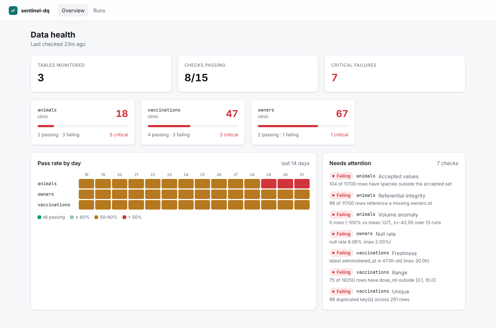
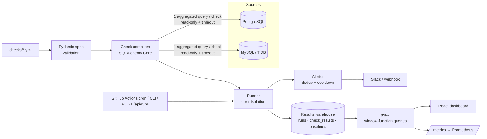
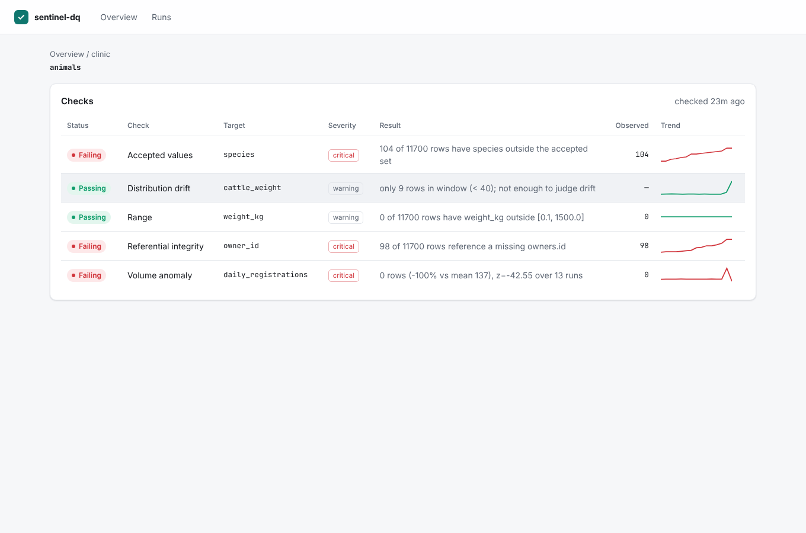
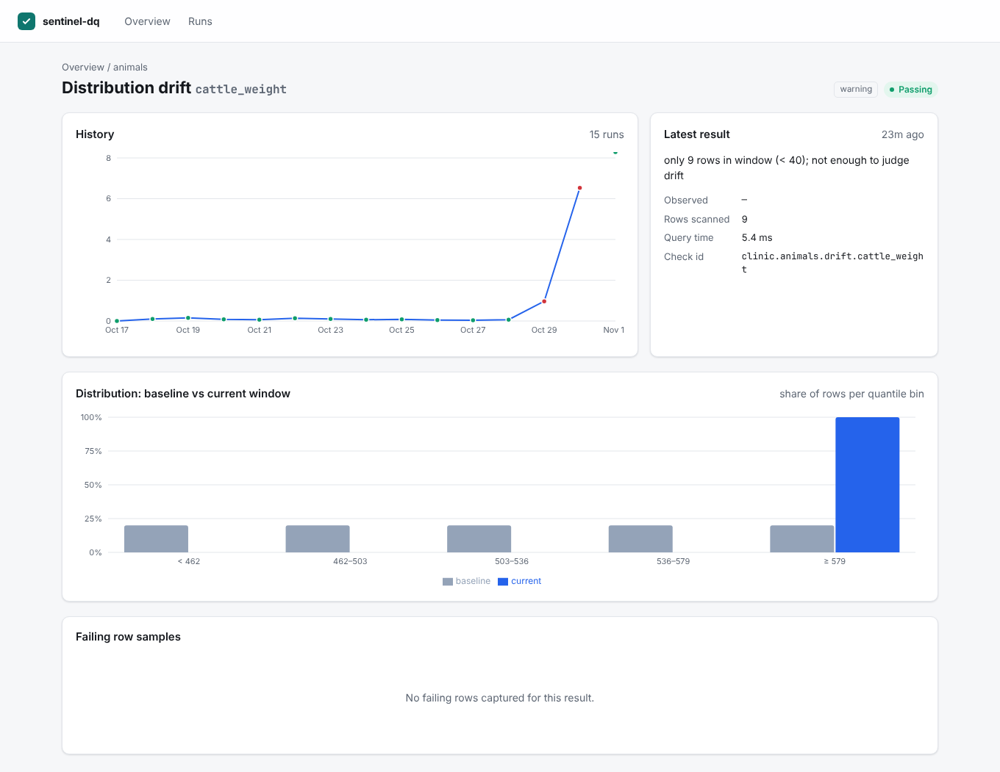

# sentinel-dq

**Declarative data-quality and drift monitoring for SQL databases.** Describe what "good data" means in YAML; sentinel-dq compiles each rule to a single aggregated SQL query, runs it on PostgreSQL, MySQL or SQLite, stores every result, alerts on state changes, and shows trends in a React dashboard.

[](https://github.com/AtishayKashyap/sentinel-dq/actions/workflows/ci.yml)


**[▶ Live demo](https://atishaykashyap.github.io/sentinel-dq/)**: the real dashboard, running on data from a simulated veterinary-clinic database with deliberately injected defects. It's rebuilt weekly by CI (`.github/workflows/pages.yml`) with no backend: `sentinel export-static` writes the API's responses as JSON, and the same React build reads them.



## Why

Broken data rarely crashes anything. It silently produces wrong dashboards, failed reminder emails, or a vaccine batch that can't be traced during a recall. sentinel-dq catches those problems at the source: null contact details, orphaned foreign keys, duplicated upstream messages, stale pipelines, volume spikes and distribution drift.

## Highlights

| | |
|---|---|
| **10 check types** | `not_null`, `null_rate`, `unique` (composite), `referential` (anti-join), `accepted_values`, `range`, `freshness`, `row_count_anomaly` (z-score), `drift` (PSI), `custom_sql` |
| **One query per check** | Built with the SQLAlchemy Core expression API: bound parameters, dialect-correct quoting, no string templating, and no `SELECT *` into Python |
| **Statistically sound** | Quantile (NTILE) bins for PSI, a z-score combined with a relative-change floor, and baselines that learn only from healthy runs ([ADR 0002](docs/adr/0002-statistics.md)) |
| **Fast** | 15 checks over 1.7M rows in about 1.8 s on Postgres. Rewriting the referential check as a hash anti-join made it **9.1× faster** ([ADR 0003](docs/adr/0003-anti-join.md)) |
| **Safe by default** | Read-only transactions with a statement timeout, `custom_sql` restricted to a single `SELECT`, and failing-row samples **PII-masked** before they are stored |
| **Operable** | structlog JSON logs with run/request IDs, Prometheus `/metrics`, `/healthz` and `/readyz`, webhook alerts with dedup, cooldown and recovery notices |
| **Free to deploy** | Neon + Render + Vercel + GitHub Actions cron ([see Deploy](#deploy-for-free)) |

## Architecture



## Quick start

```bash
docker compose up --build -d
docker compose run --rm api sentinel demo      # 14 days of simulated history
open http://localhost:8080
```

Without Docker (Python 3.11+, Node 20+, a local Postgres):

```bash
make install
createdb clinic && createdb sentinel
make demo          # builds the demo clinic DB with injected defects and runs it 15 times
make dev           # API on :8000, dashboard on :5173
```

## Writing checks

```yaml
# checks/vaccinations.yml
datasource: clinic
table: vaccinations
pii_columns: [owner_email]          # masked in samples (common PII names are auto-detected)
checks:
  - type: unique
    columns: [external_ref]
    description: Upstream messages must be ingested exactly once
  - type: referential
    column: animal_id
    ref_table: animals
    ref_column: id
  - type: null_rate
    column: lot_number
    max: 0.02
    severity: warning
  - type: freshness
    column: administered_at
    max_lag_hours: 30
  - type: drift
    name: cattle_weight
    column: weight_kg
    filter: {species: cattle}       # equality filters, always bound parameters
    recent_column: registered_at
    recent_days: 2
  - type: custom_sql
    name: vaccinated_before_registration
    sql: >
      SELECT COUNT(*) FROM vaccinations v JOIN animals a ON a.id = v.animal_id
      WHERE v.administered_at < a.registered_at
```

Typos fail fast at load time with precise errors (`sentinel validate`): an unknown check type, a bad identifier such as `"a; DROP TABLE x"`, a `min` greater than `max`, a non-`SELECT` custom query, or duplicate check IDs.

### What the compiler emits

A `referential` check becomes one statement. Postgres executes it as a parallel hash anti-join:

```sql
SELECT (SELECT count(*) FROM vaccinations) AS total,
       (SELECT count(*) FROM vaccinations
         WHERE vaccinations.animal_id IS NOT NULL
           AND NOT (EXISTS (SELECT 1 FROM animals AS ref WHERE ref.id = vaccinations.animal_id))) AS failing
```

## The demo dataset

`sentinel demo` builds a synthetic veterinary-clinic database with **known, injected defects**, then simulates two weeks of daily ingestion and runs. The end-to-end test asserts that every defect is caught **and that nothing else is flagged**.

| Injected defect | Caught by |
|---|---|
| 6% of owners have no email | `null_rate` (max 2%) |
| Animals pointing at missing owners | `referential` |
| Species typos: `dgo`, `Cat `, `bovine` | `accepted_values` |
| Negative / 55 ml vaccine doses | `range` |
| Duplicated upstream messages | `unique` |
| Cattle weights +45% in the last 2 days | `drift` (PSI 1.4 vs a noise ceiling of 0.17) |
| 6× registration spike, then zero | `row_count_anomaly` |
| Ingestion stops on the final day | `freshness` |

| Table view | Drift detail |
|---|---|
|  |  |

## API

The OpenAPI docs are served at `/docs`. The main endpoints are:

| Method | Path | |
|---|---|---|
| GET | `/api/tables` | severity-weighted health score per table |
| GET | `/api/results/latest?table=` | latest result per check (`ROW_NUMBER()` window) |
| GET | `/api/checks/{id}/history` | time series with `LAG()` delta and 7-run rolling pass rate |
| GET | `/api/heatmap?days=14` | pass rate per table per day |
| GET | `/api/results/{id}/samples` | masked failing rows |
| GET | `/api/runs`, `/api/runs/{id}` | run log |
| POST | `/api/runs` | trigger a run (`X-API-Key`, constant-time compare) |
| GET | `/healthz`, `/readyz`, `/metrics` | probes and Prometheus metrics |

## Testing

```bash
make test                                    # SQLite + Vitest
SENTINEL_TEST_PG_URL=postgresql+psycopg://... \
SENTINEL_TEST_MYSQL_URL=mysql+pymysql://...  \
  pytest                                     # the same tests on every dialect
```

- **89 backend tests, 98% coverage** (CI gate: 80%). The check, runner and API tests are parametrised over SQLite, PostgreSQL 16 and MySQL 8, using real databases rather than mocks.
- **Property-based tests** (Hypothesis) cover the statistics: PSI is non-negative, symmetric and scale-invariant; z-score signs are correct; quantile edges are strictly increasing.
- **End-to-end test** of the full simulation, including alert dedup: 165 results produce exactly 3 webhook messages.
- **Frontend:** Vitest + Testing Library. ESLint (typescript-eslint strict) and `tsc --strict` with `noUncheckedIndexedAccess`.
- **CI:** ruff, mypy `--strict`, pytest against service containers, `pip-audit`, `npm audit`, a Docker build with a smoke test, and a Trivy image scan.

## Deploy for free

| Piece | Free option |
|---|---|
| Results DB + demo source | [Neon](https://neon.tech) Postgres (or [TiDB Serverless](https://tidbcloud.com) for MySQL) |
| API | [Render](https://render.com) free web service, using `render.yaml` |
| Dashboard | [Vercel](https://vercel.com) or Cloudflare Pages: root `web/`, build `npm run build`, output `dist`, env `VITE_API_URL=https://<api>.onrender.com` |
| Scheduling | `.github/workflows/scheduled-checks.yml`: GitHub Actions cron every 6 hours |
| Alerts | Slack incoming webhook (free) |

Free web services sleep when idle, so scheduling does **not** live in the API process ([ADR 0004](docs/adr/0004-free-tier-scheduling.md)). To enable it, add the `CLINIC_DB_URL`, `SENTINEL_RESULTS_URL` and (optionally) `SENTINEL_WEBHOOK_URL` repository secrets, and set the repository variable `SENTINEL_SCHEDULE_ENABLED=true`. Seed the hosted demo once with `sentinel demo`. On an always-on host, `sentinel schedule` runs the cron from `sentinel.yml` instead.

## Project layout

```
src/sentinel/
  spec.py       Pydantic models for YAML suites (discriminated union, identifier validation)
  checks.py     check compilers -> SQLAlchemy Core statements
  stats.py      PSI, z-score, quantile edges (pure functions)
  runner.py     orchestration, read-only guard, error isolation, metrics
  store.py      results warehouse + analytical queries (window functions)
  alerts.py     webhook alerts with dedup/cooldown
  masking.py    PII masking for samples
  api.py        FastAPI app
  cli.py        Typer CLI: validate | run | demo | serve | schedule | reset-baseline
  demo.py       synthetic clinic data with injected defects
web/            React 19 + TypeScript + TanStack Query + Recharts
docs/adr/       architecture decision records
```

## License

MIT
